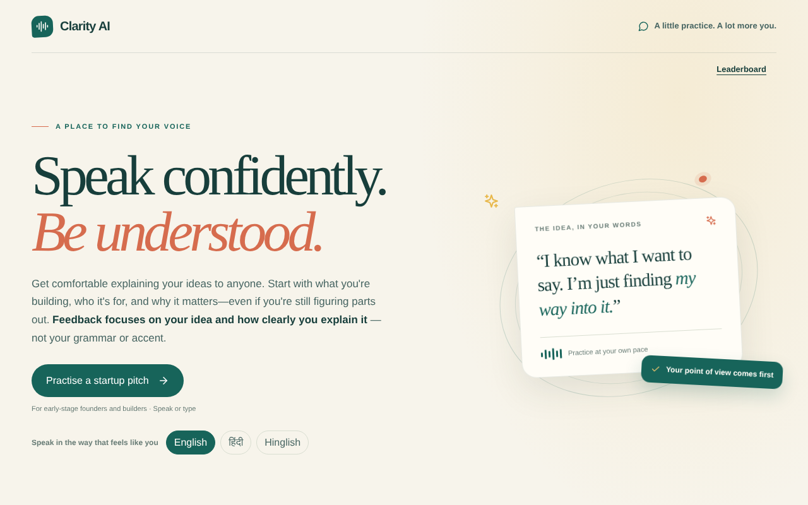
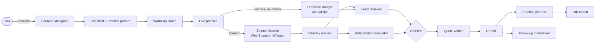
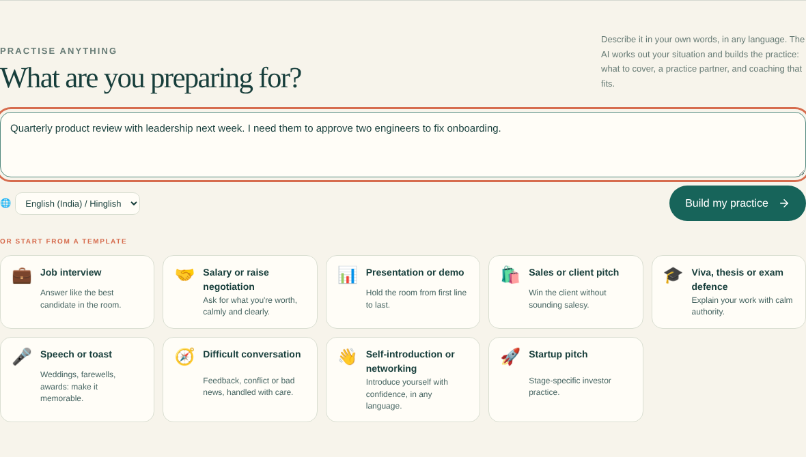
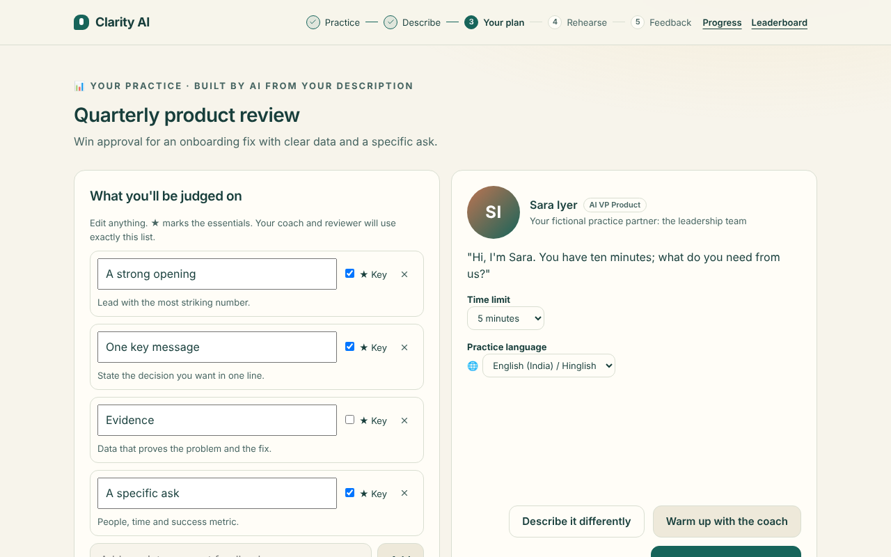
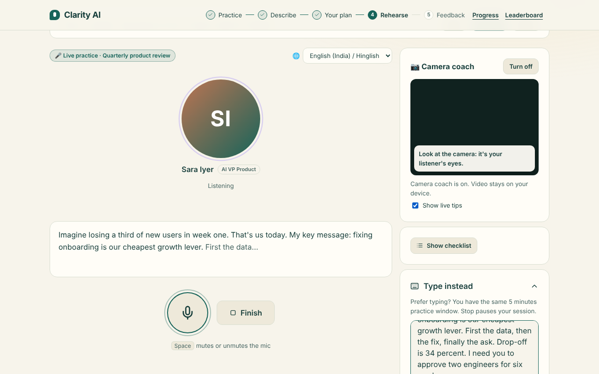
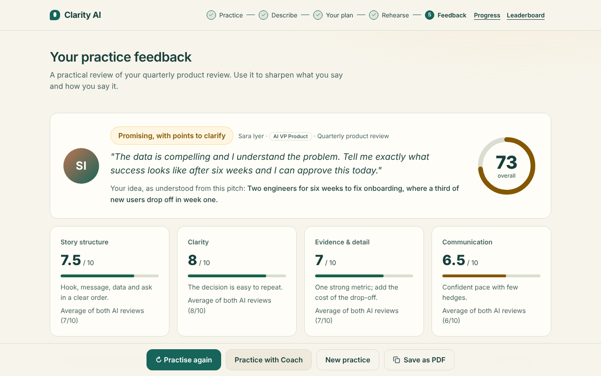
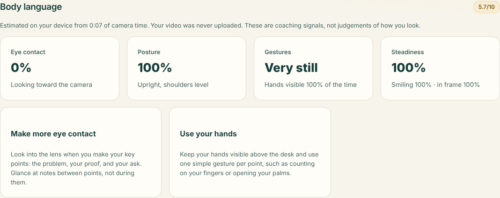
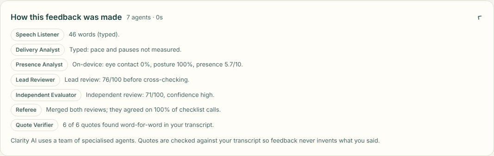
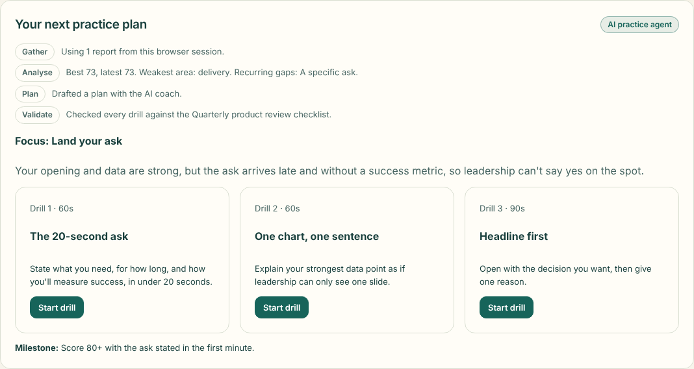
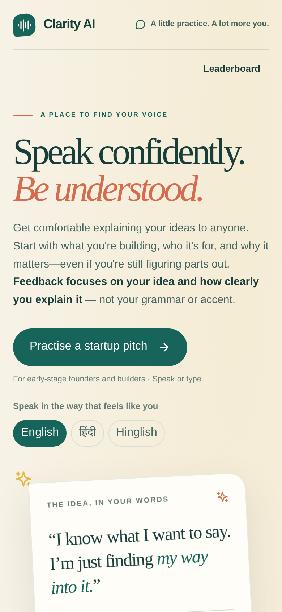

<div align="center">


# Clarity AI

**Speak confidently. Be understood.**

Rehearse any high-stakes conversation out loud with a team of AI agents.
Feedback on *what you say and how you say it*, never your grammar or accent.

[](https://github.com/tausifaman222/clarity-ai_airtribe_hackathon/actions/workflows/ci.yml)
[](LICENSE)


[**Live demo**](https://clarityai.geekypmtausif.com) · [**Setup in 10 minutes**](SETUP.md) · [Architecture](docs/ARCHITECTURE.md) · [API](docs/API.md) · [Launch kit](docs/LAUNCH.md)

<sub>Built at the <b>Airtribe AI Builders Day</b> hackathon · Made with ❤️ by Ashish &amp; Tausif</sub>



</div>

---

## Table of contents

- [Why Clarity AI](#why-clarity-ai)
- [Features](#features)
- [How it works](#how-it-works)
- [The agent team](#the-agent-team)
- [Screenshots](#screenshots)
- [Quick start](#quick-start)
- [Deploy](#deploy)
- [Configuration](#configuration)
- [Use it from AI assistants (MCP)](#use-it-from-ai-assistants-mcp)
- [Privacy and security](#privacy-and-security)
- [Project structure](#project-structure)
- [Testing](#testing)
- [Roadmap](#roadmap)
- [Contributing](#contributing)
- [Credits and license](#credits-and-license)

## Why Clarity AI

Most people know *what* they want to say. The hard part is saying it clearly, under pressure, to an interviewer, an investor, a manager or a room full of people. Practising alone gives no feedback. Practising with friends is awkward and rarely honest.

Clarity AI is a private rehearsal room:
1. Describe your situation in your own words, in any of 16 languages.
2. Rehearse out loud with a realistic practice partner.
3. Get specific, evidence-checked feedback within seconds.

It never judges grammar, accent or appearance, only substance and delivery.

## Features

| | Feature | Details |
|---|---|---|
| 🎯 | **Practise anything** | A scenario designer agent turns a plain description (*"PM interview at a fintech next week"*) into a custom checklist, practice partner and time limit. There are also 8 templates and a stage-aware startup-pitch track. |
| 🗣️ | **Voice-first, any browser** | Live captions in Chrome and Edge; open-source **Whisper** transcription in Safari and Firefox. Natural **ElevenLabs** voices; if there's no key or it fails, the free open-source **Kokoro** voice runs on the visitor's device, then the browser voice. |
| 📷 | **On-device camera coach** | **MediaPipe** face and pose landmarks give live nudges on eye contact, posture, gestures and steadiness, plus a body-language score. Video never leaves the device. |
| 🧠 | **Multi-agent review** | A lead reviewer and an independent evaluator run in parallel. A referee merges their reviews, and a quote verifier checks every quote against your transcript. |
| 🔁 | **Agentic practice loop** | A planner reads your history, finds recurring gaps and sets three drills. A drill coach and a follow-up interviewer grade each rep. |
| 🌍 | **16 languages** | English (IN/US/UK), Hindi, Hinglish, Bengali, Tamil, Telugu, Marathi, Spanish, French, German, Portuguese, Arabic, Indonesian, Japanese and Chinese. The AI replies in yours. |
| 📈 | **Progress** | Google or username sign-in, saved reports, trends, PDF export, an opt-in leaderboard and one-click account deletion. |
| 🔌 | **MCP server** | Claude, ChatGPT, Cursor and custom agents can call Clarity AI's tools through the Model Context Protocol at `/mcp`. |
| 🧩 | **Open-source first** | Open-weight `gpt-oss-120b` and Whisper on Groq, Gemini as a fallback, and MediaPipe. It works with any OpenAI-compatible API, and with no key it runs in a clearly labelled offline mode. |

## How it works



## The agent team

Each report is produced by several specialised agents, coordinated by the server. Every report shows its own trace under **"How this feedback was made"**, and the live manifest is at [`GET /api/agents`](docs/API.md#agents).

| Agent | Type | Responsibility |
|---|---|---|
| Scenario designer | LLM | Understands the use case and builds a validated practice plan |
| Warm-up coach | LLM | Coaches one point at a time and tracks checklist coverage |
| Practice partner | LLM + voice | Plays the listener: investor, hiring manager, client, examiner… |
| Speech listener | Web Speech / Whisper | Converts speech to text |
| Delivery analyst | Deterministic | Pace, fillers, hedges, pauses |
| Presence analyst | On-device vision | Eye contact, posture, gestures, steadiness |
| Lead reviewer | LLM | Scores, checklist evidence, fixes, toughest question, rewrite |
| Independent evaluator | LLM | Stricter evidence-only second review and red flags |
| Referee | Deterministic | Merges both reviews and enforces the scoring formula |
| Quote verifier | Deterministic | Checks quotes against the transcript and flags paraphrases |
| Practice planner | LLM + tools | History → analysis → plan → validation |
| Drill coach | LLM | Grades focused 60–90 s reps |
| Follow-up interviewer | LLM | Grades your answer to the hardest question |

Scores are computed by the server, never trusted from a model:

```
overall = round((structure·0.3 + clarity·0.25 + substance·0.3 + delivery·0.15) × 10), minus 10 if a ★ point is missing
```

## Screenshots

| Practise anything | AI-built practice plan |
|---|---|
|  |  |
| **Live practice with camera coach** | **Report** |
|  |  |
| **Body language (on device)** | **Agent trace** |
|  |  |
| **Practice plan agent** | **Mobile** |
|  |  |

## Quick start

You need **Node 20+**. A free Groq key gives you real AI feedback; without it the app still runs in offline mode.

```bash
git clone https://github.com/tausifaman222/clarity-ai_airtribe_hackathon.git clarity-ai
cd clarity-ai
cp .env.example .env            # set LLM_API_KEY (free at https://console.groq.com)
npm install
node --env-file=.env server.js  # → http://localhost:5000
```

Accounts, history and the leaderboard need Postgres:

```bash
# in .env: DATABASE_URL=postgres://...  and  SESSION_SECRET=<32+ random characters>
npm run db:migrate
```

Open `http://localhost:5000/api/health?deep=1` to check that every integration is configured.

## Deploy

| Host | One step |
|---|---|
| **Vercel** | [](https://vercel.com/new/clone?repository-url=https%3A%2F%2Fgithub.com%2Ftausifaman222%2Fclarity-ai_airtribe_hackathon&env=LLM_PROVIDER,LLM_API_KEY,SESSION_SECRET&envDescription=Set%20LLM_PROVIDER%3Dgroq%20and%20a%20free%20Groq%20key&envLink=https%3A%2F%2Fgithub.com%2Ftausifaman222%2Fclarity-ai_airtribe_hackathon%2Fblob%2Fmain%2FSETUP.md) |
| **Render** | [](https://render.com/deploy?repo=https://github.com/tausifaman222/clarity-ai_airtribe_hackathon) |
| **Replit** | Import from GitHub; `.replit` is included |
| **Docker** (Railway, Fly.io, Cloud Run, a VPS) | `docker build -t clarity-ai . && docker run -p 5000:5000 --env-file .env clarity-ai` |

Or run `npm run setup` on your computer: it tests every key with a real call, uploads them to Vercel, creates the tables and deploys. [SETUP.md](SETUP.md) walks through each host, Google sign-in, ElevenLabs and pointing your own subdomain (for example on Hostinger).

## Configuration

All configuration is through environment variables; see [`.env.example`](.env.example).

| Variable | Required | Purpose |
|---|---|---|
| `LLM_PROVIDER` | ✅ | `groq` (default open models), `gemini`, `openrouter`, `anthropic` or `openai` (any compatible API) |
| `LLM_API_KEY` | ✅ | Key for the provider above |
| `LLM_MODEL`, `LLM_BASE_URL` | | Override the preset model or endpoint |
| `FALLBACK_LLM_BASE_URL`, `FALLBACK_LLM_API_KEY`, `FALLBACK_LLM_MODEL` | | Backup provider, used automatically on failures or rate limits |
| `DATABASE_URL` (or `POSTGRES_URL`) | for accounts | Postgres connection string |
| `SESSION_SECRET` | for accounts | 32+ random characters |
| `GOOGLE_CLIENT_ID`, `GOOGLE_CLIENT_SECRET`, `PUBLIC_URL` | | Google sign-in |
| `ELEVENLABS_API_KEY`, `ELEVENLABS_VOICE_MEERA`, `ELEVENLABS_VOICE_COACH` | | Natural voices |
| `STT_API_KEY`, `STT_MODEL` | | Whisper speech-to-text (reuses the Groq key by default) |
| `MCP_TOKEN` | | Require a Bearer token on `/mcp` |
| `RATE_LIMIT` | | AI calls per IP per 10 minutes (default 80) |

## Use it from AI assistants (MCP)

Clarity AI is a remote MCP server (Streamable HTTP, JSON-RPC 2.0). To connect it:
1. In your MCP-capable client, add a remote server with the URL `https://YOUR-DOMAIN/mcp`.
2. If you've set `MCP_TOKEN`, add it as the Bearer token.

| Tool | What it does |
|---|---|
| `list_scenarios` | Templates and startup-pitch stages |
| `design_scenario` | Builds a practice from a plain-language description |
| `coach_turn` | One coaching reply and checklist coverage |
| `review_practice` | Multi-agent review of a full transcript |
| `plan_practice` | Next session plan with 3 drills |
| `grade_answer` | Grades an answer to a follow-up question |

## Privacy and security

- **Video** is analysed in the browser; only summary numbers (such as "eye contact 64%") are sent.
- **Audio** is transcribed and not stored. In Chrome, captions come from the browser itself.
- **Reports:** guest reports stay in the browser tab. Signed-in reports are private unless you publish one to the leaderboard.
- **Accounts:**
  - Passwords are hashed with scrypt.
  - Sessions are random tokens in HttpOnly, SameSite cookies, and only their hashes are stored.
  - Google sign-in uses OAuth 2.0 with PKCE and a signed state cookie.
- **Abuse protection:** rate limiting on AI routes, login lockout after repeated failures, and same-origin checks on account changes.
- **Deletion:** users can delete their account and all data in one click.
- See [SECURITY.md](SECURITY.md) to report a vulnerability, and the in-app [privacy policy](public/privacy.html).

## Project structure

```
├── server.js              # Express app: routes and multi-agent orchestration
├── api/index.js           # Vercel serverless entry (re-exports the app)
├── llm.js                 # Provider-agnostic LLM client, presets and fallback
├── offline.js             # Labelled keyword fallback when no AI key is set
├── server/
│   ├── agents.js          # Practice planner, drill coach, follow-up interviewer
│   ├── agent-team.js      # Agent manifest and quote verifier
│   ├── account-auth.js    # Username accounts and sessions
│   ├── google-auth.js     # Google OAuth (PKCE)
│   ├── community.js       # Saved reports and leaderboard
│   ├── voice.js           # ElevenLabs TTS and Whisper STT
│   ├── mcp.js             # MCP server
│   ├── stats.js           # Anonymous usage counters
│   ├── tracks.js          # Pitch stages and custom scenarios
│   └── db.js              # Postgres pool
├── public/                # Plain-JS single-page app (no build step)
│   ├── app.js             # Practice rooms, report, drills, progress
│   ├── home.js            # Landing and "practise anything"
│   ├── scenarios.js       # Scenario templates and validation (shared with the server)
│   ├── rubrics.js         # Startup-pitch stage rubrics (shared)
│   ├── presence*.js       # On-device camera coach
│   ├── speech.js          # Recorder and Whisper client
│   └── kokoro-voice.js    # Free on-device Kokoro voice (fallback)
├── db/schema.sql          # Idempotent schema; apply with `npm run db:migrate`
├── tests/                 # node:test unit tests and Playwright API/browser tests
├── docs/                  # Architecture, API, launch kit, screenshots
└── vercel.json · Dockerfile · render.yaml · .replit
```

## Testing

```bash
npm run test:install   # once: downloads Chromium for Playwright
npm test               # unit tests (PGlite) + API and browser tests (Playwright)
```

The suite runs against an isolated offline server with outbound network blocked. It covers:
- Google OAuth: PKCE, signed state, account reuse and deletion
- Body-language maths
- Scenario validation
- The planner's analysis
- Voice chain: ElevenLabs → on-device Kokoro (simulated model) → browser voice
- Whisper routing
- Postgres stats
- The MCP protocol
- A full browser journey: template → custom practice → camera coach (simulated vision model) → report → plan → drill

CI runs the suite on every push and pull request.

## Roadmap

- [ ] Real-time voice conversation mode for the practice partner (interruptions and follow-ups)
- [ ] Team workspaces for coaches, placement cells and accelerators
- [ ] Shareable report links
- [ ] Localised interface (not just practice language)
- [ ] Installable PWA with offline caching, then mobile app wrappers

Have an idea? [Open a feature request](https://github.com/tausifaman222/clarity-ai_airtribe_hackathon/issues/new?template=feature_request.yml).

## Contributing

Contributions are welcome. Please read [CONTRIBUTING.md](CONTRIBUTING.md) and our [Code of Conduct](CODE_OF_CONDUCT.md). Good first issues are labelled [`good first issue`](https://github.com/tausifaman222/clarity-ai_airtribe_hackathon/labels/good%20first%20issue).

## Credits and license

Built at the **Airtribe AI Builders Day** hackathon by **Ashish & Tausif**, with ❤️.

Thanks to the open-source projects that make this possible: [MediaPipe](https://github.com/google-ai-edge/mediapipe), [Whisper](https://github.com/openai/whisper), [gpt-oss](https://github.com/openai/gpt-oss), [Express](https://expressjs.com), [node-postgres](https://node-postgres.com), [PGlite](https://pglite.dev) and [Playwright](https://playwright.dev).

Released under the [MIT License](LICENSE).
